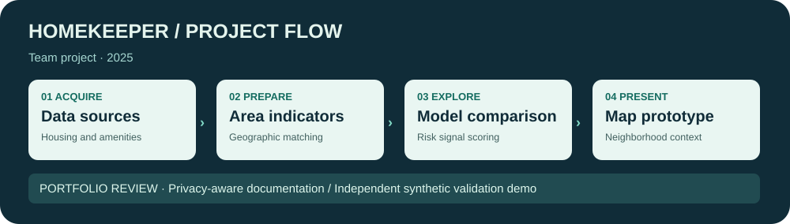
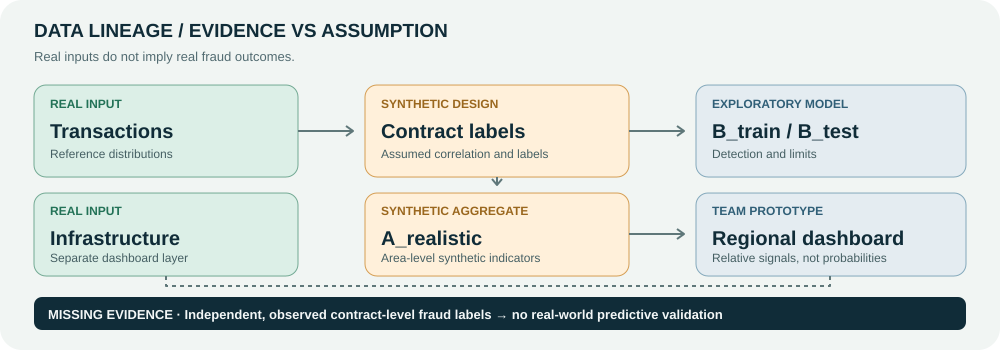

# AI 기반 주거 안정 프로젝트 · HomeKeeper

> **팀 프로젝트 포트폴리오**  
> 2025.11.17–12.16 (발표 2025.12.19) · 5인 팀 · 머신러닝 데이터 분석 부트캠프

**데이터 접근 제약 속에서 수도권의 전세 관련 위험 신호와 생활 인프라를 법정동 단위로 비교하는 지도형 서비스 프로토타입.**

> 전세사기 모델링은 대부분 가상 데이터 기반입니다. 실거래가 및 생활 인프라 자료는 실제 자료를 활용했으나, 개별 피해 계약에 연결된 실제 학습 라벨을 확보하지 못했습니다. 공개 실데이터로 실제 사기 발생을 예측했다고 주장하지 않습니다.

**협업 방식** · 저를 포함한 다섯 팀원이 데이터 수집과 전처리, 머신러닝 모델 실험, 최종 발표를 나누어 맡았습니다.



## 01. 문제와 해결 방향

전세 계약의 위험을 판단하려면 가격, 담보, 보증, 피해 이력 등 여러 정보를 함께 확인해야 하지만, 계약별 핵심 정보는 수집·열람이 어려웠습니다. 공공데이터 조사와 정보공개 요청, 국회의원 사무실 등 외부 협조 요청에도 계약별 핵심 학습 데이터를 확보하지 못했습니다. 팀은 개별 매물 판별을 목표로 출발한 뒤 데이터 확보 한계를 인식하고, 법정동 단위의 상대적 위험 신호와 생활 인프라를 비교하는 방식으로 범위를 전환했습니다.

| 단계 | 팀 프로젝트에서 수행한 내용 |
| --- | --- |
| 데이터 확보 | 공공데이터 조사 및 외부 기관 데이터 협조 요청 |
| 전처리 | 실거래 분포를 활용한 가상 계약·라벨 설계, 법정동 매칭 및 집계, Min-Max·로그/Z-score, 분위수 매핑 검토 |
| 모델 비교 | Orange·Python으로 선형회귀, 랜덤 포레스트, 그래디언트 부스팅 비교 |
| 위험 지표 설계 | 선행연구 방향을 참고한 가정적 상관구조·가중 점수, FINAL_v4 및 가중치 전후 비교 |
| 서비스 | 법정동 경계와 인프라 정보를 결합한 지도형 웹 프로토타입 |

## 02. 팀 프로젝트의 기술 구성

- 분석: Python, Pandas, Orange
- 공간 처리: 법정동 코드, GeoJSON/SHP, 공간 매칭 및 등치지역도
- 웹: PHP, MySQL, AWS Lightsail, Cloudflare
- 서비스 화면: 전세 관련 위험 신호, 범죄 관련 지표, 학교·학원·교통·공원·병원·체육시설·대규모 점포 등

발표자료에 기재된 팀 기술 구성입니다. 실제 웹 소스·DB 스키마·학습 스크립트와 운영 상태는 확인되지 않아 이 저장소에 포함하지 않았습니다.

## 03. 검토에서 발견한 중요한 한계

- B_train(가상 학습), B_test(별도 가상 테스트), A_realistic(실거래 분포 기반 가상 동별 분석) 역할 분리 기록이 있었으나 원 생성 코드 및 파일 대응은 확인되지 않았습니다. B_test의 사기 탐지 부진과 클래스 불균형은 독립 평가의 필요성을 보여줍니다.
- 초기 개별 데이터에 정답 후보와 보험 가입 변수가 완전히 일치하는 구조가 있어, 정답 누수 위험이 확인되었습니다.
- 법정동 통계에는 목표 비율을 계산할 수 있는 동기간 피해·거래 건수가 포함되어 있어 입력 변수 선택에 주의가 필요합니다.
- 실거래 기반 가상데이터와 실제 검증 데이터의 경계, 분할 방법 및 가중 점수 산출 경로를 독립적으로 확인하지 못했습니다.
- 따라서 발표의 높은 성능은 가정으로 만든 라벨·지표를 다시 학습한 결과일 수 있으며, 실제 피해 예측이나 독립 실측 검증 성과로 제시하지 않습니다. 실제 사기 발생 확률, 매물의 안전성, 지역의 안전 등급을 뜻하지 않습니다.



## 04. 이 저장소에서 직접 실행할 수 있는 예제

원본 팀 코드를 복원한 것이 아니라, **별도로 새로 작성한 합성데이터 기반 검증 예제**입니다. 가상 구역·월별 선행 지표로 미래의 가상 위험률을 예측하며 지역과 시간을 동시에 분리합니다. 계약 분류의 불균형·분포 변화, 분위수 매핑, 집계도 시연합니다. FINAL_v4에 대해서는 발표에 보이는 여섯 가중치의 산술만 재구성하고 가상 ID로 Top10 교집합을 계산합니다. 실제 부동산 자료, 지명, 주소, 연락처 또는 부동산 의사결정에 사용할 수 있는 예측값을 포함하지 않습니다.

```bash
python -m pip install -r requirements.txt
python -m src.evaluate
python -m src.contract_demo
python -m src.score_review
python -m unittest discover -s tests -v
```

Python 3.12 환경에서 작성했습니다. 의존성 설치 후 예제 실행에는 네트워크나 계정 정보가 필요하지 않습니다.

| 경로 | 내용 |
| --- | --- |
| [docs/methodology.md](docs/methodology.md) | 팀의 분석 방법과 재설계 방향 |
| [docs/project-history.md](docs/project-history.md) | 개발 일정, 초기 기획·회의·실제 구현·후속 보완 구분 |
| [docs/synthetic-design.md](docs/synthetic-design.md) | 가상 데이터 설계, B/A 분리, FINAL_v4 여섯 가중치 및 Top10 검토 |
| [docs/model-evaluation.md](docs/model-evaluation.md) | 모델 성능 해석 및 검증 계획 |
| [docs/data-sources.md](docs/data-sources.md) | 데이터 출처·공개 범위 |
| [docs/data-catalog.md](docs/data-catalog.md) | 실측·가상·가공·미확인 데이터 카탈로그 |
| [docs/contributions.md](docs/contributions.md) | 팀의 분담 방식과 공동 성과 |
| [data/README.md](data/README.md) | 합성 예제의 스키마 및 제한 |
| [src/](src/) | 새 검증 예제 및 발표 코드의 산술 재구성 |
| [tests/](tests/) | 합성 데이터·분할·누수 점검 테스트 |

## 05. 기여 및 공개 범위

원 데이터·공문·발표 이미지·팀원 식별정보·원본 코드·지역 위험 순위는 제외했습니다. 

**이 자료는 교육 프로젝트 회고 및 검증 예시이며 실제 계약, 대출, 보험, 지역 선택에 대한 판단 도구가 아닙니다.**

